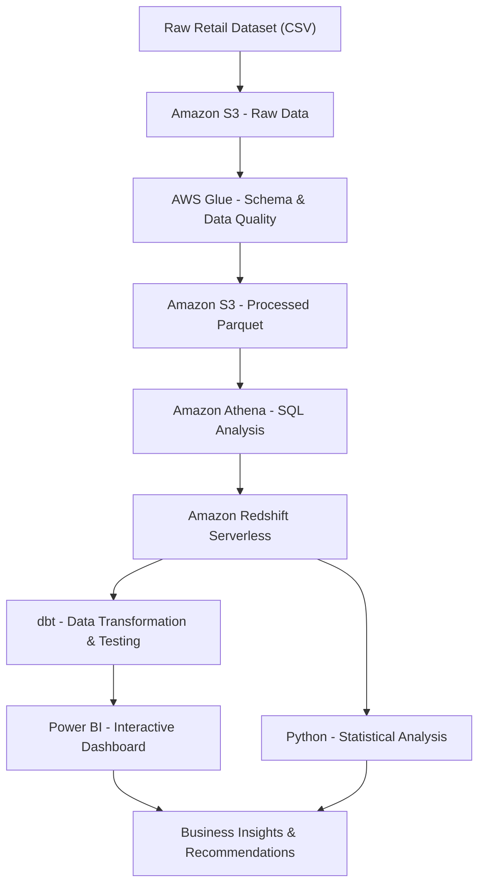

<div align="center">

# 📦 Retail Demand, Forecast Performance & Inventory Analytics

### An End-to-End Supply Chain Analytics Project

**Understanding Forecast Bias • Demand Patterns • Inventory Gaps • Business Decisions**

<br/>


<br/>

### 🔵 [View Live Power BI Dashboard](YOUR_POWER_BI_LINK)

📄 [View Project Report](Documentation/Business_Analysis_Report.md)

</div>

---

# 📌 Project Overview

Forecast accuracy plays an important role in retail supply chain planning. When demand forecasts consistently differ from actual sales, businesses may face challenges in inventory planning, replenishment decisions, and resource allocation.

This project analyzes **73,100 retail records** to evaluate forecast performance, identify demand patterns, investigate forecast bias, and understand potential inventory-demand gaps.

I built an end-to-end analytics pipeline using AWS, SQL, dbt, Python, and Power BI, then translated the findings into practical business recommendations.

### Project at a Glance

| Project Detail | Description |
|---|---|
| Project Type | End-to-End Data Analytics |
| Domain | Retail & Supply Chain Analytics |
| Dataset Size | 73,100 Records |
| Data Period | 2022–2024 |
| Stores | 5 |
| Products | 20 |
| Categories | 5 |
| Regions | 4 |
| SQL Analysis | 5 Business Investigations |
| Dashboard | 3 Power BI Pages |
| Statistical Analysis | Python |
| Final Output | Business Insights & Recommendations |

---

# 🎯 Business Problem

The supply chain planning team is concerned about the gap between forecasted demand and actual sales.

The objective is to understand whether demand forecasts are consistently overestimating or underestimating actual demand, where the largest errors occur, and whether these differences indicate potential inventory planning concerns.

### Key Business Questions

| # | Business Question |
|---|---|
| 01 | How reliable is the current demand forecast? |
| 02 | Is the forecast consistently overestimating or underestimating actual demand? |
| 03 | When and where are the largest forecast errors occurring? |
| 04 | Which stores, products, or categories show higher forecast errors? |
| 05 | Do forecast differences indicate potential inventory-demand gaps? |

The project follows a business-focused analytical approach:

**Business Problem → Data Analysis → Finding → Interpretation → Recommendation**

---

# 🏗️ End-to-End Data Pipeline

The project uses AWS services to process and transform raw retail data before making it available for business analysis.



### Pipeline Components

| Stage | Technology | Purpose |
|---|---|---|
| Data Storage | Amazon S3 | Store raw and processed data |
| Data Processing | AWS Glue | Schema handling and data quality |
| Data Format | Parquet / Snappy | Optimized processed storage |
| Querying | Amazon Athena | SQL-based data exploration |
| Data Warehouse | Amazon Redshift Serverless | Centralized analytical data |
| Transformation | dbt | Build and test analytical models |
| Visualization | Power BI | Business KPI monitoring |
| Statistical Analysis | Python | Evaluate forecast bias statistically |

---

# 📂 Dataset & Data Understanding

**Dataset:** `project3_retail_inventory_validated.csv`

The dataset contains daily retail information at the following grain:

> One record per Date × Store ID × Product ID.

### Dataset Details

| Attribute | Value |
|---|---:|
| Total Records | 73,100 |
| Total Columns | 15 |
| Date Range | 2022-01-01 to 2024-01-01 |
| Unique Dates | 731 |
| Stores | 5 |
| Products | 20 |
| Categories | 5 |
| Regions | 4 |

### Important Columns

| Column | Description |
|---|---|
| date | Daily transaction date |
| store_id | Store identifier |
| product_id | Product identifier |
| category | Product category |
| region | Store region attribute |
| inventory_level | Recorded inventory level |
| units_sold | Actual units sold |
| units_ordered | Units ordered |
| demand_forecast | Forecasted demand |
| price | Product price |
| discount | Applied discount |
| weather_condition | Weather information |
| holiday_promotion | Holiday or promotion indicator |
| competitor_pricing | Competitor price |
| seasonality | Seasonal information |

### Data Quality Checks

The dataset was validated before analytical processing.

- No missing values.
- No duplicate records.
- No duplicate Date + Store + Product business keys.
- No invalid dates.
- No invalid or negative numeric values.

**Data modeling note:** Product IDs and store IDs were not assumed to have permanent category or region mappings. These attributes were retained at the observed record level.

---

# 📊 Power BI Dashboard

The Power BI dashboard is divided into three pages, each designed to answer a different business question.

## 01. Demand & Supply Overview

**Business Question:** How does actual demand compare with forecasted demand?

This page provides an executive-level view of:

- Total Actual Sales
- Total Forecast
- Forecast Error
- Forecast Bias
- WAPE
- Forecast Accuracy
- Demand vs Forecast Trends


## 02. Forecast Performance Diagnostics

**Business Question:** Where is the forecast performing poorly?

This page focuses on:

- Forecast error patterns
- Overforecasting vs underforecasting
- Store-level performance
- Product-level performance
- Category-level comparisons
- Forecast error trends


## 03. Inventory & Demand Coverage

**Business Question:** Do forecast differences indicate potential inventory planning gaps?

This page examines:

- Inventory levels
- Demand and inventory comparisons
- Inventory coverage indicators
- Potential inventory-demand gaps
- Areas requiring further investigation


---

# 🔍 Key Business Findings

The following findings combine the Power BI dashboard, SQL investigations, and Python statistical analysis.

## 01. Forecast Performance

<details>
<summary><b>View Finding & Business Interpretation</b></summary>

The dashboard showed the following overall results:

| Metric | Result |
|---|---:|
| Total Actual Sales | 9,975,582 |
| Total Forecast | 10,345,750 |
| Forecast Error | +370,168 |
| Forecast Bias | +3.71% |
| WAPE | 6.09% |
| Forecast Accuracy | 93.91% |
| MAE | 8.30 |

**Finding:** Total forecasted demand was higher than actual sales by approximately 370K units.

**Business Interpretation:** The forecasting process shows an overall overestimation bias. Even though the overall forecast accuracy is approximately 93.91% using 100% − WAPE, the consistent positive error deserves attention.

</details>

## 02. Consistent Overforecasting

<details>
<summary><b>View Statistical Finding</b></summary>

Python analysis showed:

| Metric | Result |
|---|---:|
| Total Records | 73,100 |
| Overforecast Records | 48,783 |
| Underforecast Records | 24,160 |
| Exact Forecast Records | 157 |
| Overforecast Share | 66.74% |
| Mean Forecast Error | +5.0639 |

**Finding:** Approximately 66.74% of records showed overforecasting.

All 100 Store–Product combinations had positive average forecast error, and all 731 daily average forecast errors were positive.

A one-sample, one-tailed t-test also provided strong statistical evidence that the mean daily forecast error was greater than zero (p-value extremely small).

**Business Interpretation:** Overestimation was not limited to a few isolated records. It appeared consistently across the observed daily averages and Store–Product combinations.

</details>

## 03. Forecast Error Across Time and Segments

The dashboard and SQL analyses were used to examine how forecast performance varied across time and business segments.

**Finding:** The analysis helps identify where forecast differences deserve closer attention rather than relying only on an overall accuracy number.

**Business Interpretation:** Forecast performance should be monitored at store and product levels, not only through a single company-wide KPI.

## 04. Inventory & Demand Gaps

The dashboard compared recorded inventory levels with demand-related measures.

**Finding:** The analysis highlights potential inventory-demand gaps that may require further operational investigation.

**Business Interpretation:** Forecast overestimation can influence planning decisions, but the available dataset does not confirm actual overstock or stockout events.

---

# 💡 Business Recommendations

Based on the combined analytical findings, the following actions are recommended.

| Finding | Business Recommendation |
|---|---|
| Forecast is overestimating overall demand | Review and recalibrate forecasting assumptions |
| Overforecasting appears consistently across records | Introduce regular forecast-bias monitoring |
| Forecast performance differs across business segments | Monitor errors separately by store and product |
| Forecast differences may indicate inventory gaps | Investigate high-gap areas before changing replenishment plans |
| Overall accuracy hides the direction of forecast errors | Track Forecast Bias alongside WAPE and MAE |

### Recommended Monitoring Framework

The planning team should regularly monitor:

1. Forecast Bias — to identify systematic overestimation or underestimation.
2. WAPE — to measure overall forecast error relative to actual demand.
3. MAE — to understand average absolute error per record.
4. Store and Product Performance — to identify segments needing attention.
5. Inventory-Demand Gaps — to flag areas for further operational review.

**Expected business value:** Better forecast monitoring, more informed inventory planning, and earlier identification of areas requiring investigation.

---

# 🧪 Python Statistical Analysis

Python was used to evaluate whether the positive forecast error was consistent or simply due to random variation.

### Hypothesis

- **Null Hypothesis (H₀):** Mean daily forecast error is less than or equal to zero.
- **Alternative Hypothesis (H₁):** Mean daily forecast error is greater than zero.

Where:

```text
Forecast Error = Forecast - Actual
```

### Statistical Results

| Statistical Measure | Result |
|---|---:|
| Daily Observations | 731 |
| Mean Daily Error | +5.0639 |
| 95% Confidence Interval | [5.0011, 5.1266] |
| T-Statistic | 158.49 |
| P-Value | Extremely small |
| Significance Level | 0.05 |

### Conclusion

The statistical test provides strong evidence that the mean daily forecast error is positive under the test assumptions.

This supports the dashboard finding that the forecasting process is systematically overestimating demand in this dataset.

> Statistical significance does not establish causation. The dataset is synthetic, and the conclusion should be interpreted within the scope of this portfolio analysis.

---

# 🗄️ SQL Business Analysis

SQL was used to investigate the business problem beyond the dashboard-level KPIs.

**Five focused SQL business analyses** were completed using Amazon Redshift.

The analysis was designed to examine forecast performance and support the business questions around demand, forecast errors, and inventory planning.

The SQL queries and their outputs are available in the repository.

[View SQL Analysis](02_SQL/)

---

# 🧱 dbt Data Modeling

dbt was used to transform the staged data into analytical models suitable for reporting.

### Final Analytical Models

| Model | Purpose |
|---|---|
| `analytics.dim_date` | Date dimension |
| `analytics.dim_product` | Product dimension |
| `analytics.dim_store` | Store dimension |
| `analytics.int_supply_chain_daily` | Daily supply chain analytical model |

### dbt Validation

- 6 dbt models created.
- 12 dbt tests executed.
- dbt run completed successfully.
- Final analytical models validated for Power BI consumption.

---

# 🧮 Important KPI Definitions

| KPI | Definition |
|---|---|
| Forecast Error | Total Forecast − Total Actual |
| Forecast Bias % | Total Forecast Error ÷ Total Actual × 100 |
| WAPE | Total Absolute Forecast Error ÷ Total Actual × 100 |
| Forecast Accuracy | 100% − WAPE |
| MAE | Average Absolute Forecast Error |

**Interpretation of Forecast Error:**

- Positive value → Overforecasting.
- Negative value → Underforecasting.
- Zero → Forecast matches actual demand.

Note: Forecast Accuracy here is calculated as 100% minus WAPE. It is not the percentage of individual records with exact forecasts.

---

# ⚠️ Data Limitations & Assumptions

To keep the analysis transparent and business conclusions defensible:

- The dataset is a synthetic portfolio dataset, not real company operational data.
- The dataset does not include complete inventory movement, replenishment, or purchase-order history.
- Actual stockout events and confirmed overstock situations cannot be established from the available data.
- Inventory-demand gaps are indicators for further investigation, not proof of inventory loss.
- Statistical significance does not prove causation.
- Positive average forecast error does not mean every individual record is overforecasted.
- Dashboard and SQL outputs may use slightly different date scopes. Dashboard headline KPIs use their displayed reporting period; the full Python dataset includes 1 January 2024.

---

# 📁 Repository Structure

```text
retail-demand-forecast-inventory-analytics/
│
├── README.md
│
├── Dataset/
│   └── project3_retail_inventory_validated.csv
│
├── 01_PowerBI_Dashboard/
│   ├── Retail_Demand_Analytics.pbix
│   └── Dashboard_Screenshots/
│       ├── Page_1.png
│       ├── Page_2.png
│       └── Page_3.png
│
├── 02_SQL/
│   ├── analysis_01.sql
│   ├── analysis_02.sql
│   ├── analysis_03.sql
│   ├── analysis_04.sql
│   └── analysis_05.sql
│
├── 03_SQL_Outputs/
│   └── SQL analysis output files
│
├── 04_Python/
│   └── Statistical_Analysis.ipynb
│
├── 05_dbt/
│   ├── models/
│   ├── tests/
│   └── dbt_project.yml
│
└── 06_Documentation/
    ├── Business_Analysis_Report.md
    └── Data_Model.png
```

*Folder and file names above are a suggested repository layout. Adjust them to match the actual files uploaded to GitHub.*

---

# 🛠️ Technology Stack

| Category | Tools |
|---|---|
| Cloud Storage | Amazon S3 |
| Data Processing | AWS Glue |
| Data Querying | Amazon Athena |
| Data Warehouse | Amazon Redshift Serverless |
| Data Transformation | dbt |
| Business Analysis | SQL |
| Statistical Analysis | Python, Pandas, NumPy, SciPy |
| Data Visualization | Power BI |
| Data Modeling | Dimensional Modeling |
| Version Control | Git & GitHub |

---

# 🎯 Skills Demonstrated

- End-to-end data analytics workflow
- Business problem understanding
- Data validation and quality checks
- SQL business analysis
- Cloud data pipeline development
- Data transformation using dbt
- Data modeling
- KPI development and DAX
- Power BI dashboard development
- Forecast performance analysis
- Statistical hypothesis testing
- Business insight generation
- Data-driven recommendations

---

# 🚀 Final Project Outcome

This project demonstrates how raw retail data can be transformed into actionable business insights through a structured analytics workflow.

The most important finding was that the forecast consistently overestimated actual demand across the analyzed dataset.

By combining SQL analysis, Power BI reporting, and Python statistical testing, the project identified forecast bias and highlighted areas where inventory planning deserves further investigation.

The final objective is not just to report numbers, but to help the business understand:

**What happened → Why it matters → Where to investigate → What action to consider.**

---

<div align="center">

### 📊 Retail Demand, Forecast Performance & Inventory Analytics

**From Raw Data to Business Decisions**

<br/>

⭐ If you find this project useful, consider giving the repository a star!

</div>
